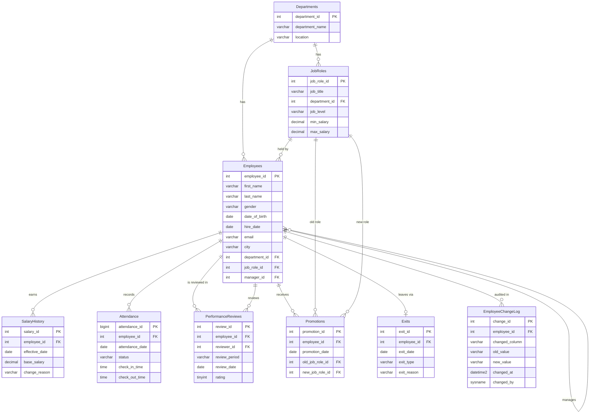

# Employee Performance & HR Analytics System

A SQL Server project that turns raw HR data (employees, salaries, attendance, performance reviews, promotions and exits) into a clean, constrained database and a set of KPIs and business insights about **attrition, performance, pay and promotion**.

> **Data notice:** all data is **synthetic**. It was generated by `data/generate_hr_dataset.py` for a fictional company of 400 employees (Jan 2022 – Dec 2025) and deliberately includes data-quality problems. No real employee data is used. Findings demonstrate the analytical method and are not claims about any real organisation.

---

## Highlights

| What | Result |
|---|---|
| Source data | 8 raw CSV files, **296,960 attendance rows**, 406 employee rows (with duplicates and errors) |
| Pipeline | `stg` (raw text) → `clean` (typed, standardised, rejects logged) → final tables (constraints enforced) |
| Final database | 8 core tables + 1 audit table; on the core schema 12 foreign keys, 14 check constraints, 7 unique constraints, plus 4 added indexes |
| Database objects | 5 views, 2 functions, 4 stored procedures, 3 triggers |
| Analysis | Dozens of queries: joins, subqueries, CTEs, window functions, KPI scorecard, cohort tests |
| Insights | 10 findings with SQL, result, interpretation, recommendation and confidence |

### KPI scorecard

| KPI | 2022 | 2023 | 2024 | 2025 |
|---|---|---|---|---|
| Headcount (year-end) | 286 | 302 | 305 | 291 |
| Attrition rate % | 8.01 | 8.50 | 9.56 | **11.07** |
| Voluntary attrition % | 6.19 | 6.80 | 8.90 | 10.40 |
| Promotion rate % | 10.93 | 11.56 | 8.24 | 14.43 |
| Average rating (1–5) | 3.40 | 3.42 | 3.41 | 3.42 |
| High performer % | 36.86 | 37.63 | 33.12 | 35.45 |
| Attendance rate % | 93.05 | 93.35 | 93.23 | 93.22 |
| Payroll cost (annual) | 193,484,000 | 208,175,000 | 219,746,000 | 220,380,000 |

### Headline findings

1. **Attrition rose every year (8.0% → 11.1%) and the increase is almost entirely resignations.**
2. **Customer Support is the fastest-worsening team** (3.1% → 17.7%); IT and Sales lose the most people.
3. **37% of reviewed leavers were rated 4–5** (regretted attrition).
4. **Negative result:** pay below the role average did *not* predict who left in 2025.
5. Promoted employees left at about half the rate of never-promoted ones, but the association weakens under a fairer test.
6. Absence is an early-warning signal: average rating falls from **4.04 to 2.80** across absence quartiles.
7. Hiring fell from 45 to 19 per year while exits rose, so **headcount fell by 14 in 2025**.
8. 65% of exits had 3 or more years of tenure, so the problem is mid-career retention, not onboarding.

Full detail: [`documentation/business_insights.md`](documentation/business_insights.md) and [`documentation/project_report.md`](documentation/project_report.md).

---

## Tech stack

- **SQL Server 2017 or later** (uses `BULK INSERT … FORMAT = 'CSV'`, `STRING_AGG`; `CREATE OR ALTER` needs 2016 SP1+)
- **SSMS** for development
- **T-SQL**: CTEs (including recursive), window functions, correlated subqueries, `CROSS APPLY`, set-based loading, transactions, `TRY…CATCH`, triggers
- **Python 3** (standard library only) for the synthetic data generator
- **Git / GitHub**

---

## Database design



The design is normalised to 3NF. Primary keys are narrow identity columns, and business rules are enforced with `UNIQUE`, `CHECK`, `DEFAULT` and foreign-key constraints. Cross-table rules that a `CHECK` cannot express (for example *exit date must be after hire date*) are enforced by triggers.

---

## Repository structure

```text
.
├── README.md
├── .gitignore
├── documentation/
│   ├── project_report.md            # full report (19 sections)
│   ├── business_insights.md         # 10 findings + action plan
│   ├── project_requirements.md      # scope, stakeholders, KPIs
│   ├── business_questions.md        # the 20 business questions
│   ├── data_dictionary.xlsx
│   ├── design_decisions.md
│   ├── dataset_description.md
│   ├── data_quality_log.md
│   ├── data_cleaning_report.md
│   ├── kpi_definitions.md
│   └── optimization_report.md
├── database/
│   ├── 01_create_database.sql
│   ├── 02_create_tables.sql
│   ├── 03_constraints.sql
│   ├── 05_indexes.sql
│   ├── staging/        # stg_01 … stg_03  (raw landing tables, load, profiling)
│   ├── cleaning/       # clean_01 … clean_08 (cleaning, final load, validation)
│   └── programmability/# functions, procedures, triggers, tests
├── views/project_views.sql
├── data/               # 8 raw CSV files + generate_hr_dataset.py
├── queries/
│   ├── 01_basic_analysis.sql
│   ├── 02_joins.sql
│   ├── 03_subqueries.sql
│   ├── 04_ctes.sql
│   ├── 05_window_functions.sql
│   ├── 06_kpis.sql
│   └── 07_advanced_analysis.sql
├── optimization/query_optimization.sql
├── screenshots/
└── presentation/project_presentation.md
```

---

## How to run it

1. **Create the database and schema** (in SSMS, run in order):
   `database/01_create_database.sql` → `02_create_tables.sql` → `03_constraints.sql`
2. **Copy the CSV files** from `data/` to a folder SQL Server can read (for example `C:\SQL_Project\data\`).
3. **Load raw data into staging:** run `database/staging/stg_01_create_staging.sql`, then edit the path in `stg_02_load_raw_data.sql` and run it. Check that every row-count reconciliation says `OK`.
4. **Profile the raw data:** `stg_03_profile_data.sql` (find duplicates, bad formats, orphans, impossible values).
5. **Clean and load:** run `database/cleaning/clean_01` … `clean_07` in order, then `clean_08_validation.sql`. Every check should pass (or each exception should be explained in the cleaning report).
6. **Add the extras, in this order:** `database/05_indexes.sql` → `views/project_views.sql` → `programmability/functions.sql` → `procedures.sql` → `triggers.sql`.
7. **Explore:** run the files in `queries/` (each query has a business question above it), for example `SELECT * FROM dbo.vw_KpiScorecard ORDER BY kpi_year;`.

If you reload the final tables later, delete from `EmployeeChangeLog` first (it has a foreign key to `Employees`).

---

## Data cleaning in one table

Raw files contained duplicates, mixed date formats, inconsistent labels, impossible values and orphan IDs. Every decision is documented and every rejected row is kept with a reason in `stg.RejectedRows`.

| Table | Raw rows | Final rows | Main treatments |
|---|---|---|---|
| Departments | 7 | 7 | None needed |
| JobRoles | 37 | 37 | None needed |
| Employees | 406 | 400 | De-duplicated; names, gender, e-mail and dates standardised; impossible hire dates and departments repaired from other tables; unknowable dates of birth set to NULL |
| SalaryHistory | 1,786 | 1,775 | Text salaries parsed; sign typos and extra-zero outliers fixed; zero salaries, orphans and duplicates removed |
| Attendance | 296,960 | 296,726 | Status spellings standardised; weekend, post-exit, blank-date, orphan and duplicate rows removed |
| PerformanceReviews | 2,234 | 2,206 | Period formats standardised; invalid ratings quarantined (never imputed); duplicates and post-exit reviews removed |
| Promotions | 137 | 132 | Dates repaired from salary records where possible; invalid rows removed |
| Exits | 116 | 109 | Types standardised; exits dated before hire quarantined for HR follow-up |

**Policy:** fix when the truth can be derived from other data, quarantine when it can't, and never invent values.

---

## KPI definitions (summary)

- **Attrition rate** = exits in the year ÷ average headcount × 100, where average headcount = (opening + closing) ÷ 2
- **Retention rate** = 100 − attrition rate; **voluntary attrition** counts resignations only
- **Promotion rate** = employees promoted ÷ average headcount × 100
- **Attendance rate** = Present records ÷ all records; **absenteeism** = Absent records ÷ all records
- **High performer %** = employees whose yearly average rating is ≥ 4.0 ÷ employees reviewed
- **Payroll cost** = sum of annual base salary of employees active at year-end

All 13 KPIs plus the extra analytical measures are defined in [`documentation/kpi_definitions.md`](documentation/kpi_definitions.md).

---

## Performance work

The only large table is `Attendance` (296,726 rows). Using `SET STATISTICS IO/TIME` and execution plans I compared non-sargable and sargable filters, join-then-aggregate vs aggregate-then-join, three ways of getting "current salary", repeated correlated subqueries vs a single pass, and `SELECT *` vs a covering index. Four indexes were added, and several were deliberately **not** added with reasons. Measured results are in [`documentation/optimization_report.md`](documentation/optimization_report.md).

---

## Database objects

| Type | Objects |
|---|---|
| Views | `vw_CurrentSalary`, `vw_EmployeeDetails`, `vw_ActiveStaff`, `vw_EmployeeDirectory` (no salary, DOB or gender), `vw_KpiScorecard` |
| Functions | `fn_AgeOn` (scalar), `fn_ActiveEmployeesAsOf` (inline table-valued) |
| Procedures | `usp_GetEmployeeProfile`, `usp_TopPerformers`, `usp_AttritionByDepartment`, `usp_PromoteEmployee` (a transaction across three tables) |
| Triggers | `trg_Exits_ValidateDates`, `trg_Promotions_ValidateDates`, `trg_Employees_TrackChanges` (audit) |

---

## Limitations

- The data is synthetic, so findings illustrate the method and are not real-world conclusions.
- Three exit records had impossible dates and were quarantined, so attrition is slightly understated.
- Managers are not reviewed in this dataset, so rating KPIs cover non-managers only.
- Department transfers are tracked only from the moment the audit trigger was added.
- Small departments (HR, Marketing) produce noisy rates, and every association reported is not proof of cause.

## Future improvements

- Power BI dashboard on top of `vw_KpiScorecard`
- A transfers table with history, and employee engagement and market-salary data
- A Python attrition-risk model (logistic regression) using the same views
- Automated loads (SQL Server Agent or SSIS) and unit tests with tSQLt
- Partitioning or columnstore for `Attendance` if it grew to tens of millions of rows

---

## Skills demonstrated

Requirements and KPI design · normalisation and ER modelling · constraints · data profiling and cleaning · staging pipelines · joins, subqueries, CTEs (including recursive) · window functions · cohort analysis · indexing and execution-plan tuning · views, procedures, functions, triggers and transactions · documenting assumptions, caveats and negative results.

---

## Author

**Your Name** · [LinkedIn](https://www.linkedin.com/in/your-profile) · [GitHub](https://github.com/your-username)
