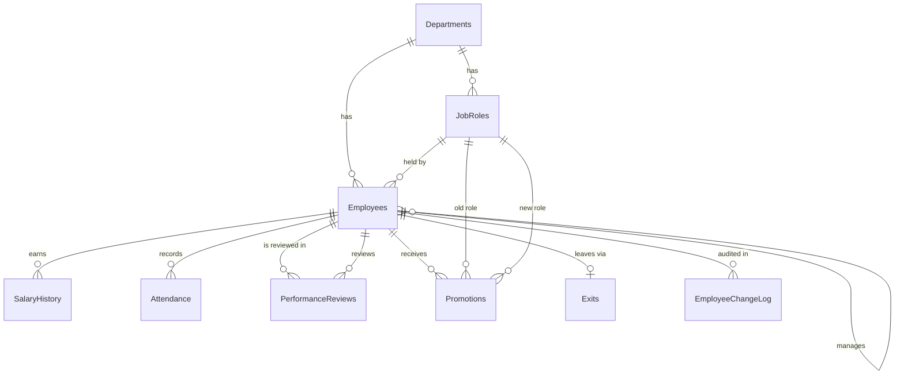

# Employee Performance & HR Analytics System: Project Report

**Database:** Microsoft SQL Server · **Period analysed:** January 2022 – December 2025 · **Data:** synthetic (fictional company, 400 employees)

---

## 1. Project title

**Employee Performance & HR Analytics System**: a SQL Server database and analytics layer for workforce performance, attendance, pay, promotion and attrition.

## 2. Problem statement

The HR department of a mid-sized company keeps employee, salary, attendance, review and exit data in separate spreadsheets. This makes it difficult to measure performance, understand why people leave, and judge whether promotion and pay decisions are fair or effective. Leadership cannot easily answer questions such as:

- Which departments lose the most people, and is the problem getting worse?
- Are we losing the people we most want to keep?
- Do pay level, promotion or absence relate to performance and attrition?

## 3. Business objective

Design and build a SQL-based system that consolidates HR data, measures workforce health with well-defined KPIs, identifies attrition patterns, and produces actionable recommendations that support data-driven decisions on retention, pay and promotion.

**Stakeholders**

| Stakeholder | Need |
|---|---|
| HR manager | Attrition trends, headcount and hiring patterns |
| Leadership | High-level KPIs, workforce cost, risks |
| Department heads | Team performance, absence, top and at-risk people |
| Compensation team | Pay fairness across roles and departments |

## 4. Project scope

| In scope | Out of scope |
|---|---|
| Employees, departments, job roles | Payroll tax calculations |
| Salary history | Recruitment pipeline |
| Daily attendance | Survey / sentiment text |
| Half-yearly performance reviews | Machine-learning models |
| Promotions and exits | Dashboards (listed as future work) |
| Data cleaning, KPIs, analysis, optimization, database programmability | Real employee data (synthetic only) |

The project answers 20 business questions (see `business_questions.md`) and defines 13 KPIs (see `kpi_definitions.md`).

## 5. Dataset description

Eight raw CSV files were generated by `data/generate_hr_dataset.py` (Python, fixed random seed) and deliberately contain realistic data-quality problems. The file-to-source-system mapping shows where such data comes from in a real company.

| File | Real-world source | Raw rows |
|---|---|---|
| `departments.csv` | Master data | 7 |
| `job_roles.csv` | Master data | 37 |
| `employees.csv` | HR information system export | 406 |
| `salary_history.csv` | Payroll system | 1,786 |
| `attendance.csv` | Biometric / swipe-card logs | 296,960 |
| `performance_reviews.csv` | Appraisal tool | 2,234 |
| `promotions.csv` | HR records | 137 |
| `exits.csv` | HR records / exit interviews | 116 |

The company has 7 departments (HR, IT, Finance, Sales, Marketing, Operations, Customer Support), 37 job roles, 400 distinct employees, annual salaries in a single currency, a 1–5 rating scale, and Monday–Friday working days. Because the data is synthetic, all findings illustrate the analytical method and are not claims about real organisations.

## 6. Database architecture

Data moves through three layers so that bad data never reaches the final tables:

```text
CSV files ──► stg schema  ──► clean schema ──► final tables (dbo)
              raw text         typed, standardised,     constraints enforced,
              (no rules)       rejects logged           indexes, views, procedures
```

| Layer | Purpose |
|---|---|
| `stg.*` (8 tables, all `VARCHAR`) | Accept the raw data exactly as it arrived so nothing fails on import; profile problems with SQL |
| `stg.CleaningLog`, `stg.RejectedRows` | Audit trail: what was changed, what was quarantined, and why |
| `clean.*` | Typed, de-duplicated, standardised copies |
| `dbo.*` (8 core tables + `EmployeeChangeLog`) | Final constrained database |
| Views, functions, procedures, triggers | Reusable logic and rule enforcement |

**Design decisions:** surrogate identity keys; exits, salary history and promotions in their own tables (history is preserved, no repeating columns); `department_id` is kept on `Employees` as a deliberate, validated redundancy; `ON DELETE NO ACTION` so HR history is never silently cascaded away; `date_of_birth` nullable because an unknowable birth date must not be invented; an audit table added to start tracking department, role and manager changes.

## 7. ER diagram




The core schema has 12 foreign keys. `PerformanceReviews` references `Employees` twice (reviewee and reviewer) and `Promotions` references `JobRoles` twice (old and new role).

## 8. Data dictionary

The full dictionary is in `data_dictionary.xlsx`. A summary:

| Table | Key columns | Notes |
|---|---|---|
| **Departments** | `department_id` (PK), `department_name` (unique), `location` | 7 rows |
| **JobRoles** | `job_role_id` (PK), `job_title`, `department_id` (FK), `job_level` (Junior / Mid / Senior / Lead / Manager), `min_salary`, `max_salary` | Salary band check: `max ≥ min > 0` |
| **Employees** | `employee_id` (PK), names, `gender`, `date_of_birth` (nullable), `hire_date`, `email` (unique), `city`, `department_id` (FK), `job_role_id` (FK), `manager_id` (self FK) | Current role and department; age ≥ 18 at hire |
| **SalaryHistory** | `salary_id` (PK), `employee_id` (FK), `effective_date`, `base_salary`, `change_reason` | Unique per employee and date |
| **Attendance** | `attendance_id` (PK, bigint), `employee_id` (FK), `attendance_date`, `status` (Present / Absent / Leave / Half-Day), `check_in_time`, `check_out_time` | Unique per employee and date; 296,726 rows |
| **PerformanceReviews** | `review_id` (PK), `employee_id` (FK), `reviewer_id` (FK), `review_period` (`YYYY-H1/H2`), `review_date`, `rating` (1–5) | Unique per employee and period |
| **Promotions** | `promotion_id` (PK), `employee_id` (FK), `promotion_date`, `old_job_role_id` (FK), `new_job_role_id` (FK) | Old role ≠ new role |
| **Exits** | `exit_id` (PK), `employee_id` (FK, unique), `exit_date`, `exit_type` (Resignation / Termination / Retirement), `exit_reason` | At most one exit per employee |
| **EmployeeChangeLog** | `change_id` (PK), `employee_id` (FK), `changed_column`, `old_value`, `new_value`, `changed_at`, `changed_by` | Written by trigger |

## 9. SQL scripts

| Folder / file | Purpose |
|---|---|
| `database/01`–`03` | Create database, tables, constraints |
| `database/staging/stg_01`–`03` | Create raw landing tables, reusable load, profiling queries |
| `database/cleaning/clean_01`–`08` | Setup, reference and employee cleaning, salary, exits and promotions, attendance, reviews, transactional final load, validation |
| `database/05_indexes.sql` | Four added indexes |
| `views/project_views.sql` | Five views |
| `database/programmability/` | Two functions, four procedures, three triggers, a test script |
| `queries/01`–`07` | Basic analysis, joins, subqueries, CTEs, window functions, KPIs, advanced analysis |
| `optimization/query_optimization.sql` | Before-and-after performance tests |

## 10. Data cleaning process

**Method:** load everything as text, profile with SQL, apply a written policy, log every action, quarantine what cannot be trusted, load inside a transaction, and validate with business-rule queries.

| Situation | Policy | Examples |
|---|---|---|
| Exact duplicate | Remove, keep the first | Employees, attendance, reviews |
| Inconsistent label or format | Standardise | Gender and status spellings, `DD-MM-YYYY` dates, text salaries |
| Truth derivable from other data | Repair and log | Future hire date from the first salary record; invalid department from the job role; bad manager replaced by the department manager; reviewer set to the department manager |
| Provable typo pattern | Repair and log | Negative salary (sign), salary ten times too large (extra zero) |
| Impossible value, truth unknown | Quarantine, never invent | Zero salary, rating outside 1–5, exit date before hire |
| Child row with no parent | Quarantine | Orphan employee IDs |
| Optional field missing | Keep NULL | City, exit reason, unknowable date of birth |
| Status contradicts punch times | Trust the status (documented assumption) | Absent with check-in times |

**Raw-to-final reconciliation**

| Table | Raw | Removed or quarantined | Final |
|---|---|---|---|
| Employees | 406 | 6 duplicates | 400 |
| SalaryHistory | 1,786 | 6 orphans, 3 duplicates, 2 zero salaries | 1,775 |
| Attendance | 296,960 | 6 blank dates, 20 orphans, 38 weekend rows, 20 after exit, 150 duplicates | 296,726 |
| PerformanceReviews | 2,234 | 17 invalid ratings, 6 after exit, 5 duplicates | 2,206 |
| Promotions | 137 | 1 orphan, 2 duplicates, 2 same-role | 132 |
| Exits | 116 | 1 orphan, 3 duplicates, 3 exits dated before hire | 109 |

Validation queries confirm the final data respects the business rules (department matches role, hire ≤ activity ≤ exit, no weekend attendance, current role equals the latest promotion, and others).

## 11. Analysis queries

Basic and advanced analysis (`queries/01`–`05`) answered the business questions, using filtering, grouping, `HAVING`, `CASE`, date, string and NULL functions, then joins, subqueries and window functions. Examples of what was answered:

- Headcount by department and year; age, tenure and gender profile; hires per year
- Salary bands, current salary per employee, payroll by department, spread within roles, and average raise on promotion (about 24.6% against 4.2% for annual increments)
- Rating distribution, top performers, departments by rating, rating trends between reviews
- Attendance and absenteeism by department and month; employees with 15 or more absences in 2025
- Promotions per year, time to first promotion (average 49.6 months), exit patterns and reasons

## 12. KPI queries

Thirteen KPIs were defined with exact formulas, denominators and periods (`kpi_definitions.md`). Two refinements relative to the first draft are documented: promotion rate uses average headcount as its denominator, and attendance rate counts Present records only (Leave and Half-Day are reported separately).

| KPI | 2022 | 2023 | 2024 | 2025 |
|---|---|---|---|---|
| Headcount (year-end) | 286 | 302 | 305 | 291 |
| Attrition rate % | 8.01 | 8.50 | 9.56 | 11.07 |
| Retention rate % | 91.99 | 91.50 | 90.44 | 88.93 |
| Voluntary attrition % | 6.19 | 6.80 | 8.90 | 10.40 |
| Promotion rate % | 10.93 | 11.56 | 8.24 | 14.43 |
| Average rating | 3.40 | 3.42 | 3.41 | 3.42 |
| High performer % | 36.86 | 37.63 | 33.12 | 35.45 |
| Attendance rate % | 93.05 | 93.35 | 93.23 | 93.22 |
| Absenteeism rate % | 2.80 | 2.71 | 2.70 | 2.81 |
| Payroll cost | 193,484,000 | 208,175,000 | 219,746,000 | 220,380,000 |
| Average salary | 676,517 | 689,321 | 720,479 | 757,320 |

Further analytical measures: 12-month retention of new-hire cohorts (100%, 90.2%, 90.6% for the 2022, 2023 and 2024 cohorts), regretted attrition (37.1% of reviewed leavers last rated 4–5), and average tenure (5.1 years for active staff, 4.5 years at exit). The scorecard is available as `dbo.vw_KpiScorecard`.

## 13. Advanced SQL queries

| Technique | Used for |
|---|---|
| Inner, left, right and self joins | Rosters with managers, team sizes, anti-joins for "never promoted" |
| Scalar, `IN`, correlated subqueries; `EXISTS` / `NOT EXISTS` | Current salary, active staff, the `NOT IN` NULL trap |
| CTEs, including chained and recursive | Payroll, tenure, cohorts, the monthly calendar |
| `UNION` / `UNION ALL` | Hires, promotions and exits per year in one table |
| `ROW_NUMBER`, `RANK`, `DENSE_RANK`, `NTILE` | Top earners per department, tie behaviour, salary quartiles |
| `LAG`, `LEAD`, `FIRST_VALUE`, `LAST_VALUE` | Raise size, rating trends, time between promotions |
| Running totals and moving averages | Monthly headcount, absenteeism trend |
| Window aggregates | Compa-ratio, talent matrix |
| Point-in-time cohort analysis | Testing whether pay and promotion predict exits |

## 14. Performance optimization

`Attendance` is the only large table (296,726 rows). Each case was measured with `SET STATISTICS IO / TIME` and the actual execution plan, and the rewrite was verified to return identical results.

| Case | Change | Lesson |
|---|---|---|
| Yearly attendance filter | `YEAR(col) = 2025` → date range, plus an index on `attendance_date` | The filter must be sargable **and** an index must exist |
| Department attendance rates | Aggregate per employee first, then join | Reduce rows before joining (if the optimizer already did this, keep the clearer form) |
| Current salary | Correlated `MAX`, `ROW_NUMBER`, `CROSS APPLY TOP 1` | Measure instead of assuming |
| Yearly headcount | Repeated correlated subqueries → one pass with `CASE` | Compute many periods in one scan |
| `SELECT *` | Select only needed columns; covering index | Avoids key lookups |

Four indexes were added (`attendance_date` with included columns, and foreign-key support on employee department, manager and promotion employee). Indexes on small tables, on low-selectivity columns, and on columns already covered by a unique constraint were deliberately **not** added. Measured results are in `optimization_report.md`.

## 15. Key findings

| # | Finding | Evidence | Confidence |
|---|---|---|---|
| 1 | Attrition is rising and is voluntary | 8.01% → 11.07%; resignations 17 → 31; terminations 3 → 1 | High |
| 2 | Customer Support is deteriorating fastest; IT and Sales lose the most people | Support 3.13% → 17.65%; IT 12.21% in 2025; Sales exit share 37% | Medium-high |
| 3 | Regretted attrition is high | 36 of 97 reviewed leavers (37.1%) were last rated 4–5 | Medium |
| 4 | Pay below the role average did **not** predict 2025 exits (negative result) | Exit rates 10.7% (under 90%), 12.0% (90–110%), 8.3% (over 110%) | Medium-low |
| 5 | Promotions look protective, but the evidence weakens under a fairer test | 16.95% vs 31.56% exit share; 2025 cohort shows no clear stagnation effect | Low-medium |
| 6 | Absence is an early-warning signal | Average rating 4.04 → 2.80 across absence quartiles | High (association) |
| 7 | Performance is stable overall, but a small group is sliding | 7 employees dropped a full point; 24 had two declines in a row | Medium-high |
| 8 | Hiring slowed while exits rose | Hires 45 → 19; headcount 305 → 291; payroll growth 0.29% in 2025 | High |
| 9 | Pay-structure anomalies | 4 employees paid above their manager; one 90% promotion raise; 2.1× spread within one role | High (facts) |
| 10 | Leavers are experienced, not new joiners | 65% of exits had 3+ years' tenure; new-hire 12-month retention about 90% | High |

Opportunities: nine active employees meet a "promotion-ready" rule (last four ratings average 4.0+, 36+ months since the last role change, Junior or Mid level), and 27 high performers are paid below 90% of their role average. One employee is on both lists.

## 16. Business recommendations

| Priority | Recommendation | Owner | Success KPI |
|---|---|---|---|
| 1 | Workload and compensation review for Customer Support | HR + Support head | Support attrition below 10% |
| 2 | Stay conversations for employees rated 4–5, starting with the underpaid high performers | Managers + HR | Regretted attrition below 37% |
| 3 | Decide the 2026 hiring policy deliberately (freeze or replace leavers) | Leadership | Headcount and workload per head |
| 4 | Review the IT and Sales manager pay bands; audit the 90% raise | Compensation team | No undocumented pay inversions |
| 5 | Mid-career development paths and faster first promotions in IT and Operations | HR + department heads | Time to first promotion; resignations after 3+ years |
| 6 | Supportive check-ins based on absence trends | Managers | Share of staff in the top absence quartile |
| 7 | Improve exit-reason capture; benchmark pay against the market | HR analytics | Exits with no recorded reason (11 now) |

## 17. Limitations

- The data is synthetic. Findings show the method, not truths about any real organisation.
- Three exit records had impossible dates and were quarantined, so attrition is slightly understated.
- Managers are not reviewed in this dataset, so rating KPIs cover non-managers only.
- Department transfers are tracked only from the point the audit trigger was added.
- Small departments (HR 18–20 people, Marketing 33–40) produce noisy rates.
- Every association reported (absence and rating, promotion and retention) is not proof of cause.
- Exit reasons are free labels and 11 are missing, so they are weak evidence.

## 18. Future improvements

- A Power BI dashboard on `vw_KpiScorecard` and the finding queries
- A transfers history table, plus engagement survey data and external market salary data
- A Python attrition-risk model (for example logistic regression) using the same views
- Scheduled loads (SQL Server Agent or SSIS) and automated tests with tSQLt
- Partitioning or a columnstore index for `Attendance` if volumes grew by orders of magnitude
- Row-level security so department heads only see their own team

## 19. Project conclusion

The project took raw, messy HR data through a documented pipeline into a constrained database, defined and calculated a consistent set of KPIs, and produced ten findings with explicit confidence levels. The central result is that **voluntary attrition is rising, concentrated in Customer Support, and costing the company many highly rated people**, while performance and attendance are stable. Some natural explanations (underpayment, long waits for promotion) were tested and **not** strongly supported, which points to better data collection (market pay, exit reasons) as the next step. The database also includes reusable views, procedures and triggers, and the main queries were tuned and measured, so the same system can be re-run on real data.

---

### Appendix: database objects

| Type | Names |
|---|---|
| Views | `vw_CurrentSalary`, `vw_EmployeeDetails`, `vw_ActiveStaff`, `vw_EmployeeDirectory`, `vw_KpiScorecard` |
| Functions | `fn_AgeOn`, `fn_ActiveEmployeesAsOf` |
| Procedures | `usp_GetEmployeeProfile`, `usp_TopPerformers`, `usp_AttritionByDepartment`, `usp_PromoteEmployee` |
| Triggers | `trg_Exits_ValidateDates`, `trg_Promotions_ValidateDates`, `trg_Employees_TrackChanges` |
| Added indexes | `IX_Attendance_date_status`, `IX_Employees_department_id`, `IX_Employees_manager_id`, `IX_Promotions_employee_id` |
